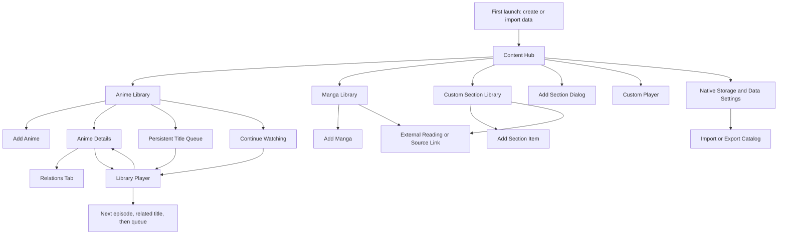

# React Native rebuild specification

Source audit: 2026-11-01. This describes the current working tree, including uncommitted changes. Source inspection only: the app has not been launched for visual or runtime verification. Current behavior, gaps, and proposed native behavior are explicitly distinguished below.

## 1. Agreed scope

- Rebuild the interface in React Native, with Windows PC, phones, and tablets as targets. Android phone/tablet is the initial mobile target; iOS/iPadOS and other desktop systems remain later scope.
- Keep local JSON file persistence. No database or hosted backend is required for the core app.
- Transfer catalog records, metadata, local cover artwork, progress, queue, relations, and custom-section data between devices. **Do not transfer video/media-library files.**
- Device-specific media paths are acceptable. Each installation selects its own media root once and can change/reselect it later.
- Keep device configuration separate from transferable data so importing a catalog does not overwrite a working media location on the receiving device.
- Preserve the existing app's behavior where intentional. Treat the listed defects and missing features as rebuild decisions rather than requirements to reproduce bugs.
- The portable package is user data, separate from the installed app binary. Different platforms install their own builds and import the same data format.

## 2. Navigation map



Global Home, Back, queue access, and Custom Player access are shared shell actions today. Diagram edges from Hub to Settings/Custom/Queue represent proposed native navigation entry points, not existing hub cards. Manga and custom-item cards open external links; neither has a working internal detail template in this checkout.

## 3. Screens and elements

### S01. Shared application shell

Current source: `templates/base.html`, `preload.js`, `main.js`, `static/js/scripts.js`, `static/css/app.css`.

Elements: Home icon, Back button, success/warning/error toasts, floating Custom Player button, queue toggle, floating queue list and Expand link, mobile Menu control, page action/filter rack. Desktop adds a custom title bar and window controls.

Queue overlay shows artwork, title/season and item context, playback link, remove action, and drag reordering. Keep it consistent with the full queue screen after every mutation.

Desktop Options currently includes backend executable/data-folder selection, anime-folder selection, opening data/config/logs, reload, fullscreen, always-on-top, developer tools, restart, reset paths, minimize/maximize/close. Native rebuild replaces backend-specific options with storage/import/export settings; retain applicable desktop window actions.

Native proposal: sidebar or navigation rail on wide layouts, compact navigation on phones, accessible queue sheet/drawer, safe-area support, platform Back behavior. No essential action may require hovering. Use toasts plus persistent inline errors for failed data writes.

### S02. Content Hub

Current source: `templates/hub.html`, `app.py:build_hub_card`, `hub`, `add_section`.

Elements: Content Hub heading; section cards with cover collage, badge, item count and title; Add Section card. Tapping a section opens its list. Empty sections still have usable cards.

Add Section dialog: name input, Create Section, Cancel, close button; dismiss through supported dialog interactions. Current slug conversion trims, lowercases and replaces spaces with underscores; creation initializes a JSON collection and cover directory. Native implementation must also reject reserved/built-in names, unsafe path characters and duplicate normalized names. Renaming/deleting sections is not implemented today.

### S03. Anime Library

Current source: `templates/index.html`, `api_anime`, `filter_library_items`, filter-state routes.

Elements:

- Continue Watching horizontal row, hidden when empty.
- Browse Anime heading, item counts, Add Anime action.
- Search box; Compact/Comfort density toggle; Top action.
- Collapsible metadata filters: genres, themes, demographics, tags; counts next to catalog values.
- Quick filters: Unwatched, Ongoing, Bookmarks; Reset; removable active-filter chips.
- Cover grid; loading skeletons; no-results state; pagination count, Prev/Next, numbered pages, page-size selection.
- Cards: cover with placeholder fallback, title, season, release status, completion styling, metadata popover; View Anime, watched toggle, bookmark toggle, Delete, Add to Queue.

Search/filter semantics: case-insensitive search across title, season, status, link and metadata in the current shared backend filter. Selected values within one metadata group use OR; different groups and quick filters combine with AND. Filtering happens before pagination. Anime is alphabetically sorted when loaded. Search/filter changes return to page 1. Preserve each library's filter state; density is currently browser-local.

Data writes: watched/bookmark flags, queue entries, saved filter state; deletion has separate consequences in section 6. Do not eagerly load all episode arrays or start preview videos for every grid card.

### S04. Continue Watching component

Current source: `templates/index.html:renderContinueWatching`, `app.py:build_continue_watching_items` and discard/progress handlers.

Elements: cover/title, watch-status label, current episode/title, elapsed/total time, percentage/progress bar, preview, Continue, Start Over, Discard. Cards are ordered by last-watched timestamp. Continue opens the saved episode with resume enabled. Start Over requests zero start. Discard removes saved tracking for that item; it does not delete the anime or media. Completed episodes disappear from active continuation.

Current video preview is lazy on hover. Native proposal: static cover by default, optional deliberate preview interaction; all controls visible or reachable by tap. Treat progress as library data so a transfer can resume on another device if its media is available.

### S05. Add Anime

Current source: `templates/add_anime.html`, `static/js/jikan_search.js`, `app.py:add_anime`, validation and Jikan routes.

Fields: optional Jikan title search/result list and status; title; free-text season (e.g. S01/Movie); release status Ongoing/Completed/Not Aired; required download/source URL; episode count >= 1; genre/theme/demographic/tag multiselect groups with custom-value entry; optional thumbnail picker and preview; duplicate/title feedback; Add Anime submit.

Flow: manual entry or select Jikan result -> inspect/edit autofill -> validate -> create records -> save cover -> refresh metadata catalog -> relation detection -> return to library. Manual form remains usable offline. Jikan-derived fields are editable. A user-selected image takes precedence over a downloaded cover; cover download failure must not discard the saved title.

Current rules: at least one metadata value across the four groups, not one per group; whitespace-normalized values; case-insensitive duplicate check on title + season + release status, plus duplicate Jikan/MAL ID prevention. Existing custom metadata can be redirected to its existing group; new values have a confirmation flow. Title safety feedback accounts for Windows filename restrictions.

Current save generates a title/season folder and numbered episode records with anticipated `1.mp4` etc. Native proposal: catalog-only creation must work without permission to create media directories. Allow optional folder linking; preserve current generation behavior only where the selected location supports it. New ID allocation must not reuse deleted identities in a way that reconnects stale progress/queue records.

### S06. Anime Details — Details tab

Current source: `templates/anime_detail.html`, `app.py:anime_detail`.

Elements: Details/Relations tabs; poster; aggregate file-availability indicator; title; season/total/completed/percentage summary; overall progress bar; last watched episode/date; release-status selector and pill; whole-title watched toggle; source link and editable URL with Save Link; Open in Explorer with result/error text; grouped metadata chips.

Episode section: optional title input plus Add Episode. Each episode card has preview/artwork, episode number/title, file indicator, Unwatched/In Progress/Completed badge, progress/time, Play/Continue/Start Over/Rewatch as appropriate, watched toggle, Delete.

Add Episode appends max(number)+1 and a default file reference. Current episode deletion removes the record and renumbers remaining episodes; see the identity issue in section 6. Current title toggle does not mark every episode watched. Rebuild must synchronize whole-title and episode states; see the phase plan for the chosen transition rules. Display release status separately from watch progress.

File availability: current Electron bridge checks direct paths and then season-folder matches; aggregate indicator and per-episode indicators update asynchronously. Native states should distinguish checking, available, missing, permission unavailable and unsupported format. Open in Explorer becomes platform-appropriate Reveal/Open Location where supported; otherwise offer Locate/Relink.

### S07. Anime Details — Relations tab

Current source: `templates/anime_detail.html`, `anime_relations.py`, relation API handlers.

Elements: ordered related-title cards; current-title marker; cover/title/season/release status; completed/total/percentage; Open; Remove for other titles; local-title search and Add; Edit Order, Save Order, Cancel, Reset Default, Check Relations; mode and status feedback.

Editing supports drag and explicit Up/Down controls. Draft reordering is separate from committed order. Cancel restores saved order. Reset restores inferred default order. Manual additions merge related groups. Manual removals create blocked pairs so a subsequent automatic scan does not silently restore removed relationships; manual re-add clears the block. Deleting a title cleans invalid memberships.

Automatic detection normalizes titles, strips common season/part/type tokens and uses similarity rules. Default ordering uses season/type information; port the actual helper rules and fixtures rather than replacing them with a substring match. These groups are playback sequences, not merely decorative recommendations.

### S08. Library Video Player

Current source: `templates/player.html`, `static/js/player.js`, subtitle/track helpers in `static/js/scripts.js`, playback-target functions in `app.py`.

Elements: title and season; video surface; play/pause, seek/time, +/-10 second skip, volume/mute, fullscreen, speed options 0.5/0.75/1/1.25/1.5/2; picture-in-picture control where supported; now-playing episode; episode picker; Audio selector; Subtitles selector/off; SRT/VTT import; Back to Anime Details; previous/next panels with labels, cover/preview and target context.

Resume after media metadata is ready, only when explicitly requested and saved time is usable. Start Over/Rewatch begins at zero. Save progress every 8 seconds during playback, on pause, and on exit/background. Playback ending saves completion and advances exactly once; a slow save must not hang navigation. Mobile background/interruptions require native lifecycle handling rather than browser unload events.

Next priority: next episode in current title -> next playable related title -> next eligible queue title. Related/queued title start: most recently resumable unfinished episode (>1 second), else first unwatched episode, else first episode. Preserve queue cursor while moving through relations and skip queue entries already covered by that relation group. Previous priority: preceding episode -> preceding relation's final episode -> preceding eligible queue title's final episode. No valid target disables that action.

Important distinction: backend progress marks an episode watched at >=90% or explicit completion; frontend auto-advance waits for actual media end. Do not advance as soon as the 90% threshold is reached.

Desktop shortcuts: Space play/pause; Left/Right +/-10 seconds clamped to bounds; Up/Down volume +/-10%; F fullscreen; M mute. Typing/editable controls retain their keys, focused buttons retain Space activation, held toggle keys must not toggle repeatedly. Native players should expose equivalent touch controls and accessibility actions.

Native codec, audio-track, subtitle, fullscreen and PiP support must be demonstrated per target. Existing filename support does not prove the codec inside a file can play.

### S09. Persistent Queue

Current source: `templates/queue.html`, shared shell queue, `add_to_queue`, `build_enriched_queue`, queue mutation routes.

Actual unit is an **anime title**: new records are `{id, title}`, duplicate title IDs are rejected. Historical records may contain `episode`. Direct queue-row Play/Start currently uses that field or episode 1; automatic continuation into a queued title resolves its starting episode dynamically. The native proposal is to use the same resume/first-unwatched resolver for both entry paths. Keep title-queue semantics explicit in UI copy; current text often incorrectly says queued episodes.

Elements: queued count; current position/remaining count; Start, Clear Watched, Clear with confirmation, Library; first/last statistics; ordered rows with drag handle, cover, position, Now indicator, title/season, progress/completed episodes/remaining count, Play, Top, Remove; empty state linking to Anime Library.

Mutations persist immediately and update both drawer and screen; reorder validates a complete permutation. Native reorder also needs move buttons for keyboard and assistive use. Preserve playback identity when reordering, rather than relying solely on a mutable array index.

### S10. Manga Library

Current source: `templates/manga_index.html`, manga API and normalization helpers.

Elements: Browse Manga, Add Manga, search, compact density/Top, metadata groups and counts, Unread/Ongoing/Bookmarks/Reset, removable chips, cover cards, loading/empty states, pagination. Each card shows title/status, metadata popover and completion/bookmark styling; View Manga opens external URL; Edit Link opens a dialog with URL, Save, Cancel/close; Mark as Read, Bookmark, cycle release status, Delete.

Manga load normalizes legacy data shapes and derives metadata from older fields. Preserve imported unknown fields and inspect normalization helpers during implementation. There is no chapter reader or chapter-level reading progress in the present source.

### S11. Add Manga

Current source: `templates/add_manga.html`, `app.py:add_manga`.

Fields: optional Jikan search/autofill; required title; Ongoing/Completed/Hiatus; required reading/download URL; metadata picker with custom values; optional cover picker/preview; duplicate/title feedback; Add Manga. Duplicate rule is title alone and duplicate external MAL ID. At least one metadata selection is required. Save catalog/cover, rebuild manga headers and return to list. Manual cover overrides downloaded cover; retain successful record on online cover failure.

### S12. Custom Section Library

Current source: `templates/section_index.html`, section routes.

Parameterized by section slug. Elements: section heading, search, Compact/Comfort, Top, active chips, grid, loading/empty states, pagination; rack offers Reset, Unread, Ongoing, Bookmarks and link to adding an item through the page UI. Cards have cover/title/status, View (external), Edit Link (prompt), Read toggle, Bookmark, release-status toggle, Delete.

Custom sections have no metadata-group picker in the current UI. Current status action toggles Ongoing/Completed even though add form offers Hiatus. Saved filters are keyed by section; density is also section-specific. No built-in local movie/TV player attachment or chapter reader exists for these items.

### S13. Add Custom Section Item

Current source: `templates/add_section_item.html`, `add_section_item`.

Fields: title, Ongoing/Completed/Hiatus, URL, optional thumbnail and preview, duplicate/title feedback, Add. Duplicate rule: title + status + link. Successful save returns to the section grid. Native form must keep values after a recoverable save error.

### S14. Custom Player / temporary playlist

Current source: `templates/custom_player.html`, `blueprints/custom_player_routes.py`, shared player helpers; desktop file-launch handling in `main.js`.

Elements: current-media title, shared audio/subtitle/SRT controls, New Session, video or empty prompt, now-playing bar, Previous/Next with boundary placeholders, Jump To dropdown, multi-file picker/drop zone, import progress/status, playlist count/list/current marker, reorder handles, Clear.

Flow: import/drop multiple files -> append temporary copies to playlist -> play first item if idle -> jump/previous/next/auto-next through list -> clear/new session removes temporary copies. Desktop open-with launch imports one file. Existing route can also accept a URL; there is no dedicated URL-entry field in the screen.

Current custom progress endpoint logs progress only; persistent resume is not implemented. Current empty saved-progress object reinforces this. Session media is cleaned at startup/shutdown/new session. Native implementation should prefer granted source references or explicitly owned temporary copies; never delete original picked media. This session is not part of catalog transfer. If persistent custom playlists are desired, define that as a new feature.

### S15. Storage and Data Settings — proposed new screen

This replaces backend/path setup rather than reproducing Flask executable configuration.

Elements: current catalog name/revision; create/open/import catalog; export catalog; device media-root picker and status; relink/check files; backup/restore; import summary/conflict warning; optional diagnostic export; desktop-specific window options where applicable. First launch offers create empty catalog or import existing data, then optional media-folder selection. Browsing and metadata editing must work when media is absent.

## 4. Existing persistence map

All names below are current storage names, not evidence that every optional file is present. No private library contents are included in this document.

| Current file/location | Contents / role | Transfer policy |
| --- | --- | --- |
| `data/sections.json` | Available content sections | Include |
| `data/anime_data.json` | Title IDs, titles/seasons, release status, links, metadata, episode records, flags, external source; legacy absolute media paths | Include records; separate device locations |
| `data/manga_data.json` | Manga records, metadata, flags, external source | Include |
| `data/<section>_data.json` | Custom-section records | Include registered sections only |
| `data/anime_tracking.json` | Per-title/per-episode resume state, last use, queue mirror, timestamps | Include; do not depend on copied absolute video path |
| `data/queue.json` | Ordered title queue; legacy episode field may exist | Include |
| `data/anime_relations.json` | Ordered groups, custom order and blocked pairs | Include |
| `data/unique_anime_tags.json` | Metadata values/counts | Include or regenerate after validation |
| `data/unique_manga_headers.json` | Manga metadata catalogs/counts | Include or regenerate after validation |
| `data/anime_filter_state.json`, `manga_filter_state.json`, `section_filter_state.json` | Search/filter/page preferences | Optional; default local in new app |
| `static/anime_images`, `manga_images`, `<section>_images` | Local cover artwork | Include artwork, not media-library videos |
| `data/anime_library.json` | Current machine's anime root | Device-only; do not restore another device's root |
| Electron user-data `config.json` | Executable/data/media paths, app setup | Device-only; retire backend settings |
| `instance/custom_player_data/custom_playlist.json`, `static/custom_media` | Temporary custom-player session/copies | Exclude |
| Logs, PID/instance registries, temp/cache, backups | Runtime/recovery files | Exclude from normal transfer |

Current covers use secured title-based filenames, WebP for new covers, and legacy extension/name fallbacks. Keep cover resolution during legacy import. New ID-based cover names avoid title collisions; migrate references explicitly.

## 5. Data-only transfer and device media locations — proposed contract

### File layout

```text
App private storage/
  catalogs/<catalog-id>/
    manifest.json
    data/                  # JSON collections, queue, tracking, relations
    artwork/               # local cover images
  device-settings.json     # roots, permission handles, density preferences
  cache/                   # regenerable thumbnails/previews
  backups/

Exported catalog package/
  manifest.json
  data/
  artwork/
```

ZIP is a proposed transfer container, not a requirement to use a database. JSON stays the authoritative format. Export may also support an unpacked folder. Media remains wherever the user already stores it on each device; copying the catalog never copies videos.

Manifest: format name, schema version, stable catalog ID, revision, export timestamp, application version and included-file inventory/checksums. IDs and references survive round trips. This package is not promised to be writable by the old Flask app; backward-compatible export would be a separate requirement.

### Media mapping

Store a logical media-root key and series/season-relative media reference in transferable records where possible. Store the actual device path or OS permission handle in device settings. Device-specific absolute paths may still exist locally; they are not authoritative on a receiving device.

Example: transferable reference `{root: "anime", relativePath: "Example Show/S01/episode-01.mkv"}`; Windows maps `anime` to `D:\Anime`; an Android installation maps it to the user's selected folder through a storage-provider handle. Same catalog/episode identity, different physical locations. A relative reference is a file locator, not a request to transfer that file.

If devices use different folder layouts, support a per-title folder override or explicit episode-file mapping on that device. A single root selection works only when the relative layout matches; do not promise one-click discovery of arbitrary renamed/moved files. Missing files leave the catalog usable. Relink only changes local mappings.

Do not construct Android document URIs by concatenating path strings. Resolve children using the provider API. On Apple platforms, selected external folders require the appropriate security-scoped access lifecycle. Permission handles cannot be transferred between devices and may need reauthorization if a folder moves.

Official platform basis: [Android document and directory access](https://developer.android.com/training/data-storage/shared/documents-files), [Apple directory access](https://developer.apple.com/documentation/uikit/providing-access-to-directories). React Native filesystem/player dependencies must be checked against these requirements and each target's actual support before selection.

### Export / import flow

1. Export from a consistent saved snapshot; wait for outstanding writes. Include records/artwork and manifest; omit roots, permissions, videos and temporary sessions.
2. User transfers the package through a file manager, USB, sharing or their chosen storage service. No automatic cloud synchronization is assumed.
3. Receiving installation stages the package, validates schema/IDs/references/file inventory and available space, and presents counts and revision before applying it.
4. First import creates a catalog. For an existing matching catalog, version 1 proposes explicit **replace from snapshot**, with a local backup; retain receiving device's root bindings. Do not silently merge two edited catalogs.
5. For a different catalog ID, create a separate catalog rather than merging overlapping legacy integer IDs. User can select the active catalog.
6. If no local media root is configured, offer a picker. Check representative files and show available/missing counts. Catalog browsing works regardless.
7. Export updated data back to another device as needed. If both devices changed independently, show divergence and preserve both snapshots; automatic conflict merging is outside initial scope.

Record IDs must be stable. Preserve existing legacy IDs on initial import and consistently map them to any new stable IDs across episodes, tracking, relations and queue. Do not identify a title using its display name or a filesystem path.

### Local write and recovery rules

- Serialize mutations through a repository layer; UI components never overwrite whole files from stale screen state.
- Validate JSON before committing; never replace unreadable data with an empty array as an automatic recovery action.
- For app-private storage, stage and replace files safely. A multi-file change needs a recoverable journal or revision snapshot so catalog, tracking and queue cannot be left at mixed revisions after interruption.
- If writing to a document provider/export destination, do not assume desktop rename atomicity. Write a new verified package before declaring export complete.
- Keep a last-known-good backup; surface read-only storage, no space, revoked permission and partial import errors with retry/reselect actions.
- Core data browsing/editing is offline. Only metadata search/cover fetch and opening remote URLs require network access.

## 6. Verified gaps and behavior decisions

| Finding in current source | Native rebuild treatment |
| --- | --- |
| Manga/custom detail routes render missing templates; list cards actually open external links | Preserve external-link flow. Do not invent internal detail/reader screens as existing behavior |
| Queue documentation says episodes; add handler persists unique titles | Rebuild as title queue initially; update labels and acceptance criteria |
| Direct queue Play defaults to episode 1 while automatic queue continuation chooses resume/first unwatched | Proposed correction: use the same starting-episode resolver for both |
| Clear Watched checks a legacy episode field defaulting to episode 1, not whole-title completion | Proposed correction: remove titles with all existing episodes watched; decide how whole-title manual flag participates |
| Whole-anime watched toggle changes a title flag but not all episode flags | Whole-title watched toggle sets all episode states; episode edits recompute title completion; clear corresponding resume entries |
| Deleting anime recursively deletes season media directory and removes cover; queue cleanup/catalog counts can be stale | Media deletion is intentional. Preserve it with confirmation, validated device-local scope and transactional reference cleanup |
| Episode deletion renumbers remaining records, but only removes deleted tracking key | Use stable episode IDs and keep displayed episode numbers/file mappings intact; migrate old tracking references before edits |
| New integer IDs reuse gaps, potentially reconnecting stale references | Use stable non-reused IDs, and clean queue/progress/relations transactionally |
| Manga status uses `Haitus` in cycling but add form uses `Hiatus` | Normalize both to `Hiatus` on import; preserve original unknown fields in backup |
| Custom-item form allows Hiatus but status toggle only alternates ongoing/completed | Provide one explicit status enum/selector consistently |
| UI page sizes 10/15/20/25/50 conflict with persisted-state allowed set 8/12/16/24 and default 12 | Use one shared page-size definition; migrate unsupported values predictably |
| Custom progress only logs; shared player coerces UUID media IDs to Number | Keep session identities as strings; do not advertise persistent custom resume until implemented |
| Custom playlist reorder relies on indices, which can change current-media meaning | Track active item by stable media ID |
| Some sort helpers exist without visible controls; README overstates sorting controls | Alphabetical default is confirmed. Any user-selectable sorting needs an explicit new control and test |
| File extension match/video MIME declaration does not establish decoder capability | Verify real codec fixtures on each platform and provide a useful unsupported-file state |

## 7. Native components and service boundaries

Shared components: AppShell, SectionCard, LibraryToolbar, SearchField, QuickFilterBar, MetadataFilterGroup, ActiveFilterChips, VirtualizedCoverGrid, CoverCard, MetadataSheet, PaginationControls, ContinueWatchingCard, ProgressBar, StatusSelector, FileAvailabilityBadge, EpisodeCard, RelationList, QueueDrawer, QueueRow, EntryForm, MetadataPicker, CoverPicker, LinkEditor, ConfirmDialog, Toast, EmptyState, ErrorState, NativePlayerControls.

Shared TypeScript services: CatalogRepository (JSON reads/writes/revisions), AnimeService, MangaService, SectionService, MetadataCatalogService, ProgressService, QueueService, RelationsService, PlaybackResolver, ImportExportService, LegacyMigrationService, optional JikanClient.

Platform adapters: StorageAdapter (pick/read/list/write/stat/copy/permission recovery), MediaResolver (root/title/episode mappings and fallback discovery), PlayerAdapter (tracks, captions, seek, duration, lifecycle, fullscreen/PiP), ExternalLinkAdapter, DesktopWindowAdapter. Node.js is not required inside the mobile app. Shared domain services call adapters instead of Python endpoints.

Use virtualized lists and bounded previews. Cache folder listings within one availability check, perform checks asynchronously, and invalidate on relink/import/manual rescan. Browse summaries should not carry full episode lists. Do not carry Electron process/PID/backend idle-shutdown machinery into the native app.

## 8. Core flow acceptance checklist

| Flow | Required observable outcome |
| --- | --- |
| Create empty catalog -> Hub -> add section -> add item | Section/count/artwork/record survive restart |
| Add anime manually without internet | Valid record/episode placeholders saved; manual metadata and cover usable |
| Search Jikan -> select -> edit -> save | User edits preserved; duplicate provider ID blocked; network failure recoverable |
| Search + metadata + quick filters -> details -> Back | Correct AND/OR filtering and list state restored |
| Play -> pause -> restart -> Continue | Saved position restored after player is ready |
| Play beyond 90% before actual end | Watched completion may update; no early auto-navigation |
| Actual playback end | Save completion; next target selected once using episode -> relation -> queue priority |
| Edit relations -> cancel/save -> rescan | Draft cancel works; saved custom order and blocked removals survive restart |
| Add/reorder/remove queue items | Unique title semantics; overlay/full page and active identity stay consistent |
| Toggle episode/title watched | Clearly defined effects; correct progress and continue-watching cleanup |
| Delete anime | Linked device-local season folder is deleted intentionally after confirmation; stale references cleaned; other roots untouched |
| Edit manga/custom link/status/read/bookmark | Correct local write and immediate card refresh; restart persists values |
| Pick custom media -> reorder -> end -> clear | Active identity preserved, temporary cleanup never removes originals |
| Export PC catalog -> import on phone | Same titles/metadata/artwork/progress/queue/relations; zero videos copied |
| Link different phone media root | Local playback works; catalog IDs/data unchanged |
| Import updated catalog back to PC | PC root retained; revision/backup handling visible |
| Missing media / revoked folder access | Browsing works; relink action; no automatic catalog deletion |
| Interrupt write/import or run out of space | Prior valid data recoverable; no false success or partial live snapshot |
| Two devices edited independently | Divergence shown; no silent last-writer overwrite/merge |
| Phone/tablet/desktop layouts | Touch, keyboard, screen reader, rotation and resize preserve all essential actions |

Existing behavior fixtures worth porting: `tests/test_app_features.py`, `test_anime_relations.py`, `test_player.js`, `test_episode_availability.js`, `test_library_path_resolution.py`, `test_library_paths.py`, `test_jikan_client.py`, `test_custom_media_cleanup.py`. These were inspected as specifications, not executed during this documentation task.

## 9. Initial implementation outline (superseded by phased plan)

1. Build a Windows + Android filesystem/player proof of concept; include iOS/iPadOS checks if those targets are required. Verify folder permissions, real media codecs, subtitles and background saves before choosing dependencies.
2. Implement JSON repositories, stable identities, legacy importer and data-only round-trip transfer; demonstrate PC root survives reimport.
3. Build shell, Hub, generic library components, filters and add forms.
4. Add anime details, file checks, tracking and native playback.
5. Add relation/queue playback resolution and both queue presentations.
6. Add Manga/custom sections and temporary Custom Player.

This document maps source behavior and proposes a rebuild contract; it does not implement or visually validate the new app. See `current-source-inventory.md` for a generated route/function and template-control index.
